# Bulk COGS Editor for WooCommerce

Review and update product costs in bulk, or transfer costs with CSV and Excel files, directly from your WooCommerce admin.

Bulk COGS Editor works with **WooCommerce’s native Cost of Goods Sold (COGS)** feature. Its refreshed three-step editor helps you find products, compare current and proposed costs, choose which records to update, and explicitly confirm before background processing starts. Product selling prices stay untouched. Save reusable filters in **Presets**, inspect past operations in **History**, review rollbacks, and manage retention in **Settings**.

**Version:** 1.3.0 · **License:** GPLv3 · **HPOS compatible**

[Documentation](https://wpbydinesh.wordpress.com/2026/10/11/bulk-edit-woocommerce-cogs/) · [Video demonstration](https://youtu.be/sOEOg0xiqYs) · [Report an issue](https://github.com/dineshinau/bulk-cogs-editor-for-woocommerce/issues)

## 1. Bulk edit overview

Open **Products → Bulk COGS Editor** to access the five tabs. **Bulk edit** guides you through **Select products**, **Set cost update**, and **Review & confirm**, keeping product matching, cost calculation, and approval in one workflow.

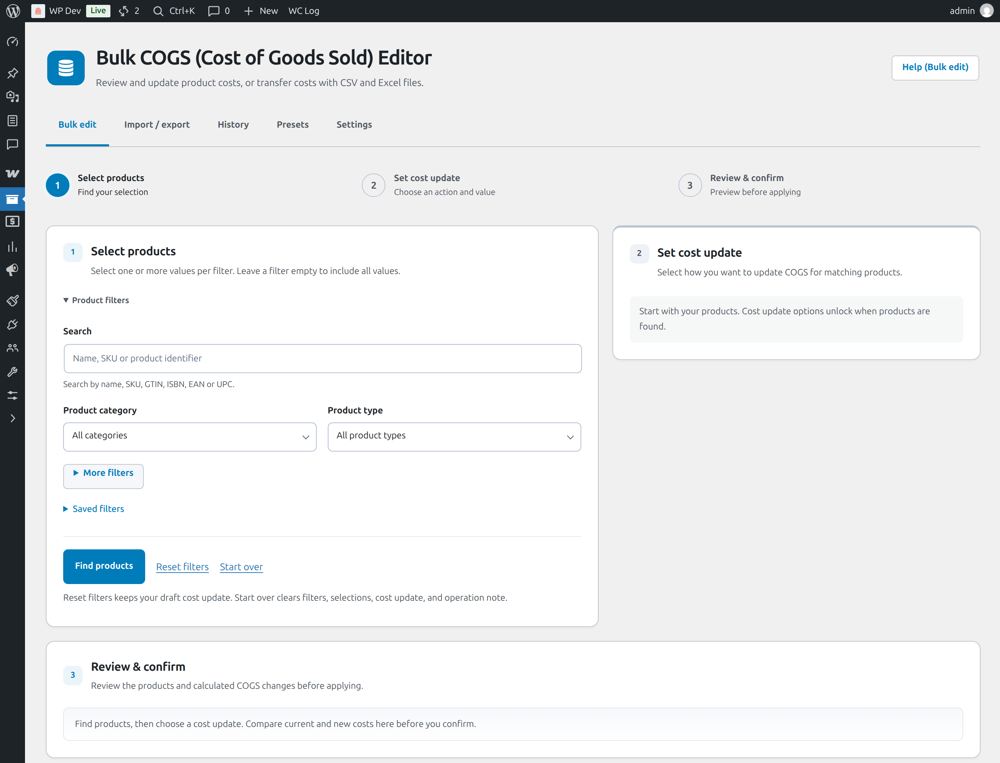

Open a screenshot to inspect its original resolution. The walkthrough follows **Bulk edit → Import / export → History → Presets → Settings**.

## Contents

- [Requirements and installation](#requirements-and-installation)
- [Features](#features)
- [Bulk editing workflow](#bulk-editing-workflow)
- [CSV export](#csv-export)
- [CSV and Excel import](#csv-and-excel-import)
- [History and rollback](#history-and-rollback)
- [Saved filter presets](#saved-filter-presets)
- [Settings](#settings)
- [Background processing and recovery](#background-processing-and-recovery)
- [Frequently asked questions](#frequently-asked-questions)
- [Development and support](#development-and-support)

## Requirements and installation

| Requirement | Minimum |
| --- | --- |
| WordPress | 6.7+ |
| WooCommerce | 10.3+ |
| PHP | 7.4+ |
| WooCommerce COGS | Enabled in WooCommerce settings |

1. Install the plugin through WordPress, or upload the plugin folder to `wp-content/plugins/bulk-cogs-editor-for-woocommerce/`.
2. Activate **Bulk COGS Editor for WooCommerce**.
3. Enable WooCommerce’s native Cost of Goods Sold feature.
4. Open **Products → Bulk COGS Editor**.

If COGS is unavailable or disabled, the editor explains what is required. Use a packaged plugin build when installing a ZIP; a source checkout needs its dependencies and compiled assets for development.

### 2. Enable WooCommerce Cost of Goods Sold

Open **WooCommerce → Settings → Advanced → Features**, enable **Cost of Goods Sold**, and save the WooCommerce settings. The plugin uses this native feature to read and write product costs; enable it before preparing your first update.

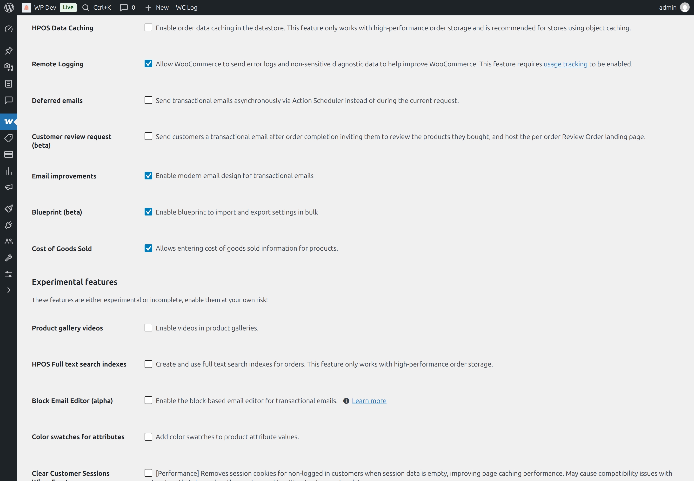

## Features

Version **1.3.0** refreshes the editor around a three-step workflow, adds
account-based filter presets in a dedicated **Presets** tab, and improves
history, import/export, and recovery guidance. The top-level tabs are **Bulk
edit**, **Import / export**, **History**, **Presets**, and **Settings** (for
users with WooCommerce management access).

### Find the products you need

- Combine searches by product name, SKU, GTIN, ISBN, EAN, or UPC with category, product type, stock status, brand, price, and current COGS filters.
- Search inside multi-select filter menus, select individual options or all options, and see selected-option counts.
- Include child categories when choosing a parent category. Variations match categories through their parent product.
- Keep primary filters close at hand and expand **More filters** for additional criteria.
- Remove individual filter chips, clear filters, or start a new selection.
- See the full matching count with separate product and variation totals.

Brand filtering appears when a public product brand taxonomy is available. Category option counts come from WooCommerce’s stored product counts. They do not count variations as separate records and do not change when you adjust other filters. Choose **Find products** to see the matching total and its product and variation breakdown for the current filter combination.

### Set, adjust, or clear costs

| Action | Example |
| --- | --- |
| Set exact cost | Set matching products to 25.00 |
| Increase by percentage | Increase existing costs by 5% |
| Decrease by percentage | Reduce existing costs by 10% |
| Increase by fixed amount | Add 2.50 to existing costs |
| Decrease by fixed amount | Subtract 1.00 from existing costs |
| Clear cost | Remove the saved COGS value |

The editor shows contextual fields, an illustrative before-and-after example, and a warning for clearing costs. Calculations use store decimal precision and half-up rounding; decreases stop at zero.

Relative adjustments skip products without a saved cost. Use **Set exact cost** to assign missing costs. WooCommerce treats zero as an empty cost; clearing uses the COGS API’s null value.

### Preview and choose your update scope

- Compare current COGS, new COGS, and the amount and percentage of each change before applying. Increases are green and decreases red, with directional arrows.
- Keep your preview and selection when visiting another tab and returning to the same editor.
- Identify products through images, names, SKUs, and product edit links.
- Show or hide optional columns and retain display preferences.
- Browse 10, 20, 50, or 100 records per page, or jump directly to a page.
- Select the current page, all matches, individual records across pages, or the first or last number of matches.
- See the selection total across pages and keep the action visible in a sticky summary.
- Review the action, selection scope, and preview review coverage in the confirmation dialog.

Individual selections support up to **500 products**. All-matching and range selections support larger scopes. Outdated preview rows remain visible for context, but selection and confirmation are disabled until fresh results are ready. A nearby **Refresh preview** control helps recover when needed.

Previous rows can remain visible while results refresh or another page loads. Wait for the refresh to finish, or use **Refresh preview** when prompted. Review the fresh results before confirming.

### Guidance and responsive controls

The **Bulk edit** workflow is arranged in three numbered stages: **Select products**, **Set cost update**, and **Review & confirm**. Contextual Help follows the selected **Bulk edit**, **Import**, or **Export** task. File requirements, cost examples, nearby validation messages, and recovery controls guide each workflow. Documentation and video links remain available.

The interface uses colored workflow icons, clear step numbers, larger mobile touch controls, sticky table headers, and fixed selection and product columns on small screens. The action summary accounts for device safe areas.

### Product and variation support

Costs are written through WooCommerce CRUD APIs for simple, variable, grouped, external, and custom product types, and for variations. Variations are separate records: selecting only variations does not change their variable parent’s cost.

## Bulk editing workflow

1. In **Select products**, set filters and choose **Find products**. Review the matching products and their current costs.
2. In **Set cost update**, choose an exact cost, a percentage or fixed adjustment, or clear the cost. The preview shows proposed costs and changes; select the products to update.
3. In **Review & confirm**, add an operation note if useful, review the selected scope and rollback choice, then confirm. Follow background progress and inspect the completed results.

Previewing does not change product costs. Updating begins only after confirmation.

### 3. Choose filters and a cost action

Use the primary filters and expand **More filters** to narrow the product selection. Choose an exact cost, a percentage or fixed increase/decrease, or clear existing costs. The expanded saved-filter controls let you name a reusable preset for your account; choose **Find products** to load matching records.

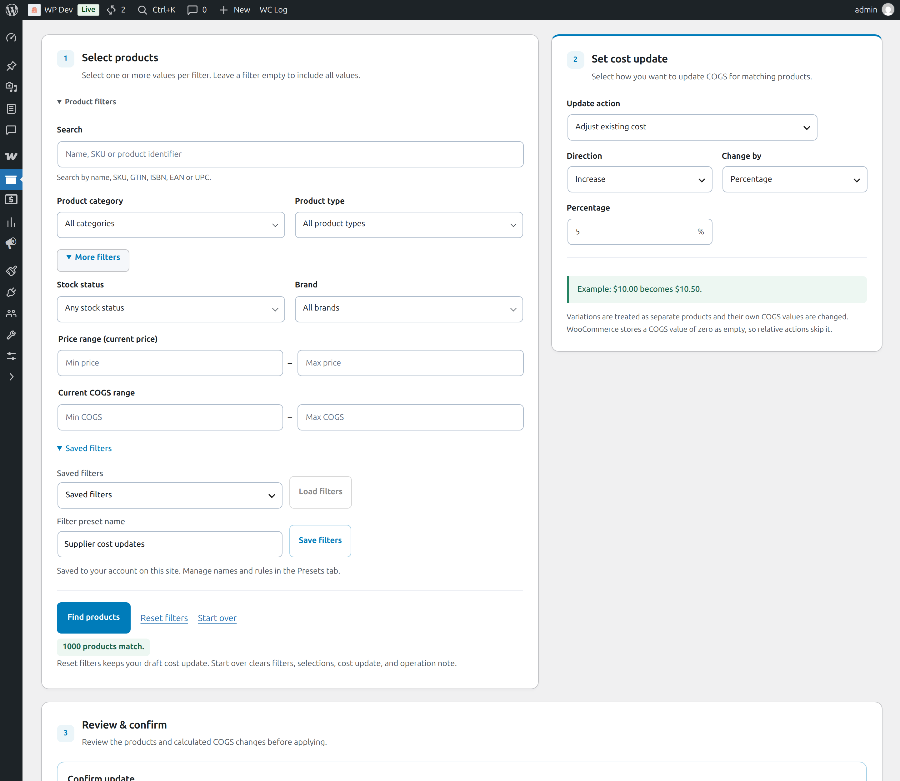

### 4. Review 1,000 selected products

Compare **Current COGS**, **New COGS**, and each difference before applying changes. This example selects the first **1,000 products** for a **5% increase**. Review the selection count, use pagination to inspect rows, adjust visible columns when needed, and add an operation note to identify the update in History.

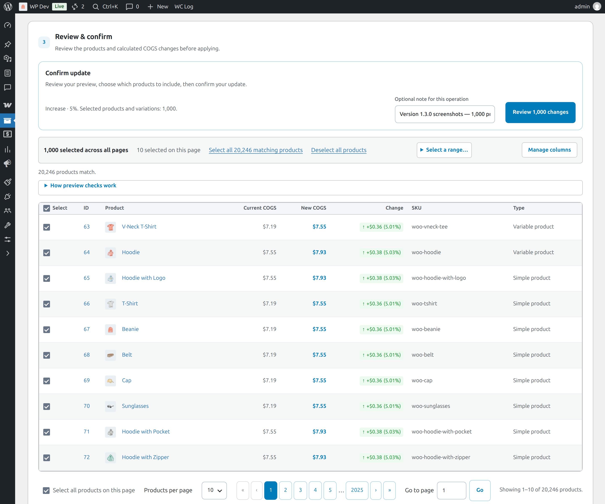

### 5. Confirm with rollback history

Choose **Review changes** to check the action and selected scope in the confirmation dialog. Enable **Keep rollback history** to retain original costs and detailed product changes for the configured retention period. These records allow a later rollback review; the update starts only when you confirm.

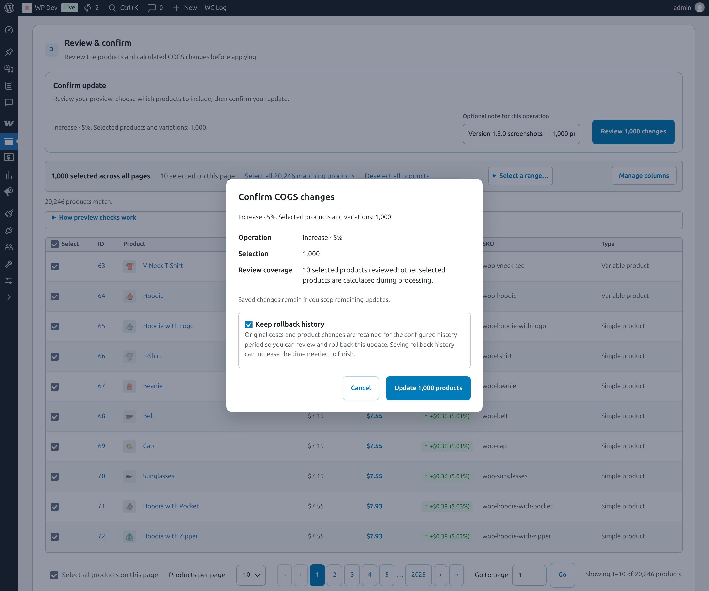

### 6. Confirm without rollback history

The alternative confirmation leaves **Keep rollback history** unchecked. The operation still records results and protects against repeated processing, but it cannot restore original costs through rollback or retain detailed cost-change history. This can reduce processing time; choose the history option separately for each update.

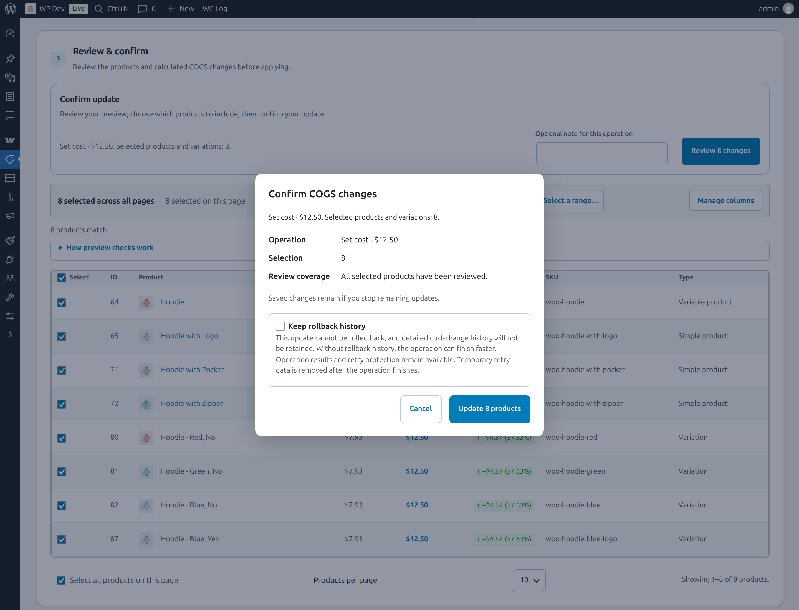

### 7. Update started: 0 of 1,000

After confirmation, the operation panel shows the background update starting at **0%**, with the selected total and outcome counters. Follow its status and use the refresh control when needed. The job continues on the server if you leave the page.

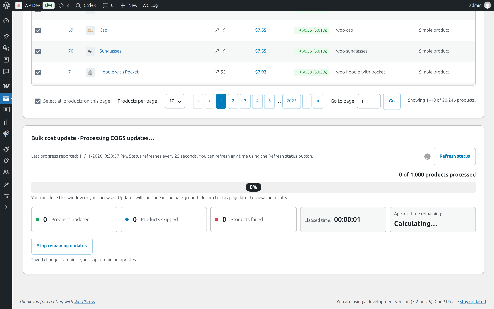

### 8. Update halfway: 500 of 1,000

At **50%**, the same operation has processed **500 of 1,000 products**. The panel displays updated, skipped, and failed counts alongside elapsed time and an estimated remaining time when available. Estimates change as processing continues and depend on the store and worker availability.

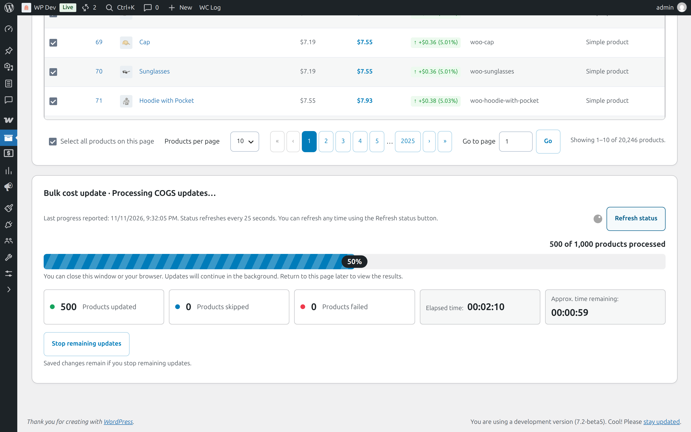

### 9. Confirm stopping remaining updates

Choose the stop control to review the cancellation dialog before stopping remaining work. Costs already saved stay changed, so stopping an operation does not restore its original values. Cancel the dialog to keep processing; use retained history to review a rollback when restoration is needed.

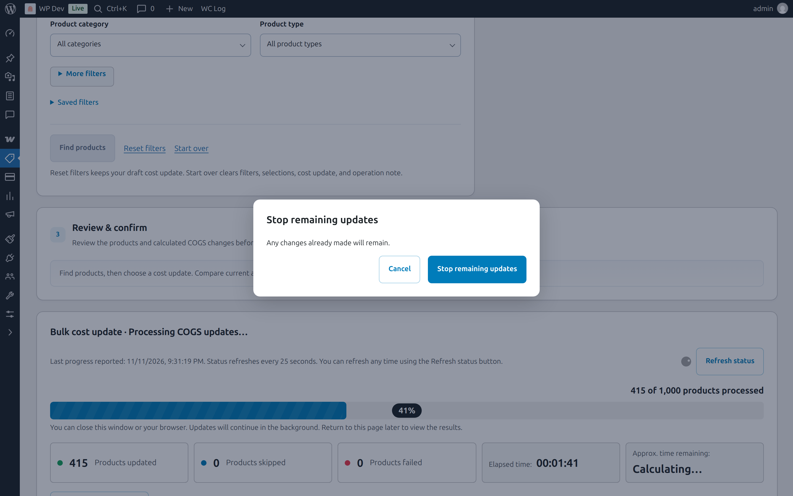

### 10. Update completed: 1,000 of 1,000

The completed example shows **1,000 products processed**, with **zero skipped and zero failed**. Review the final counters and elapsed time before starting another operation. You can also verify saved values in **Products → All Products**, using WooCommerce’s **Cost** column.

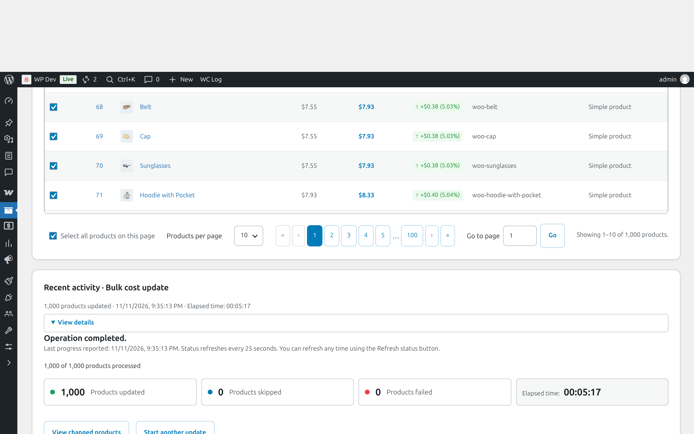

## CSV export

Use exports to review existing costs in a spreadsheet or prepare a file for importing new values.

1. Open **Import / export** and choose **Export CSV**.
2. Choose the output columns and filter the products.
3. Find and preview the matching products.
4. Start the export and wait for server-side file generation.
5. Use the explicit download link when the file is ready.

Exports cover **all matching pages** and always append a blank `new_cogs` column. Fill that column to prepare cost updates. Product type filters determine whether variable parents, variations, or both are included. Export produces CSV, including when the source of a previous import was XLSX.

### 11. Configure a CSV export

In **Import / export**, choose **Export CSV**, set product filters, and choose output columns. Find the matching products and review the export preview. Exports cover all matching pages and append a blank **new_cogs** column so the downloaded file can be prepared for a later import.

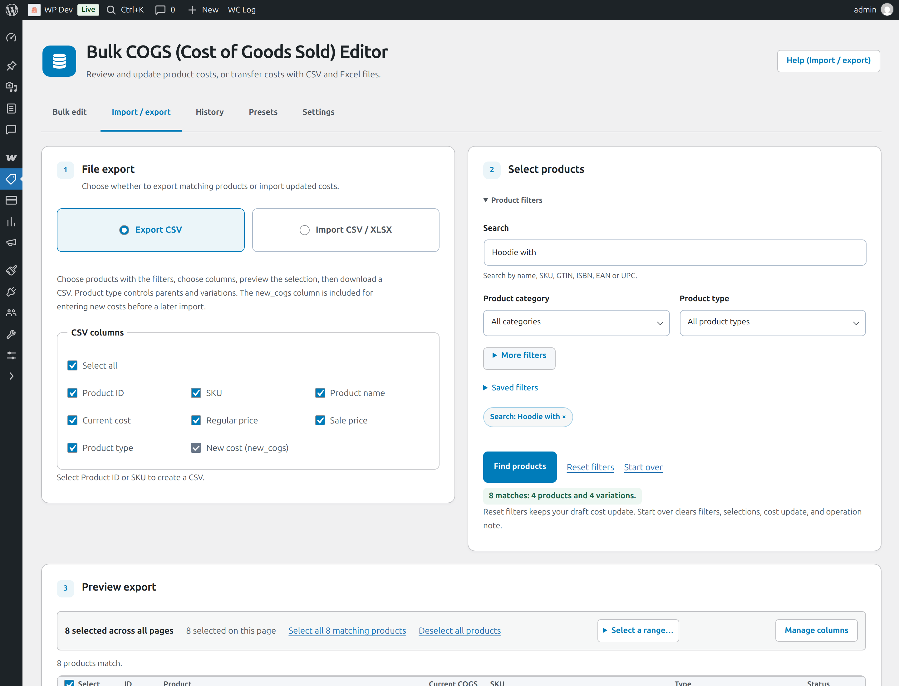

### 12. Confirm the CSV export

Review the confirmation dialog for the selected product count and output columns before creating the file. This step generates an export of matching product data without changing saved costs. Return to the preview if the product scope or column selection needs adjusting.

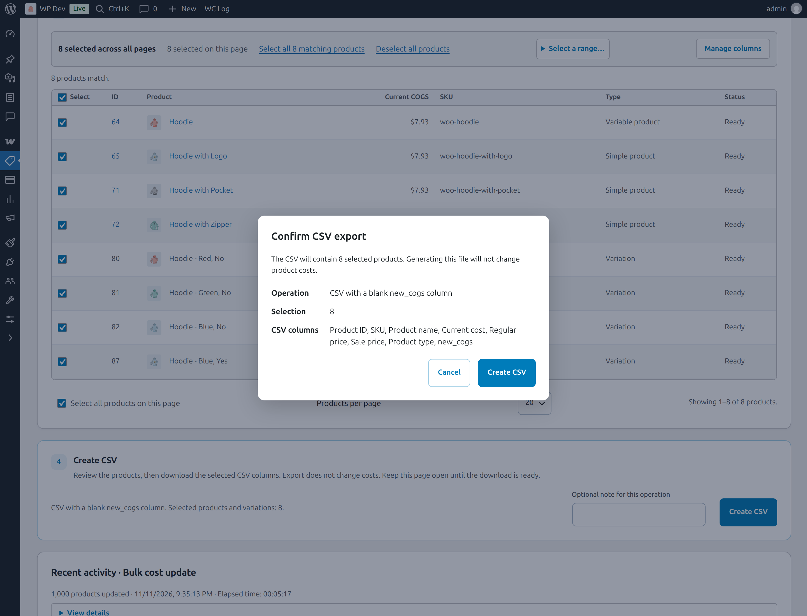

### 13. Follow CSV generation progress

After confirming, the export runs in the background. Its progress panel reports processing status, elapsed time, and estimated remaining time when available, with a cancellation control for unfinished work. Wait for file generation to complete before attempting to download the result.

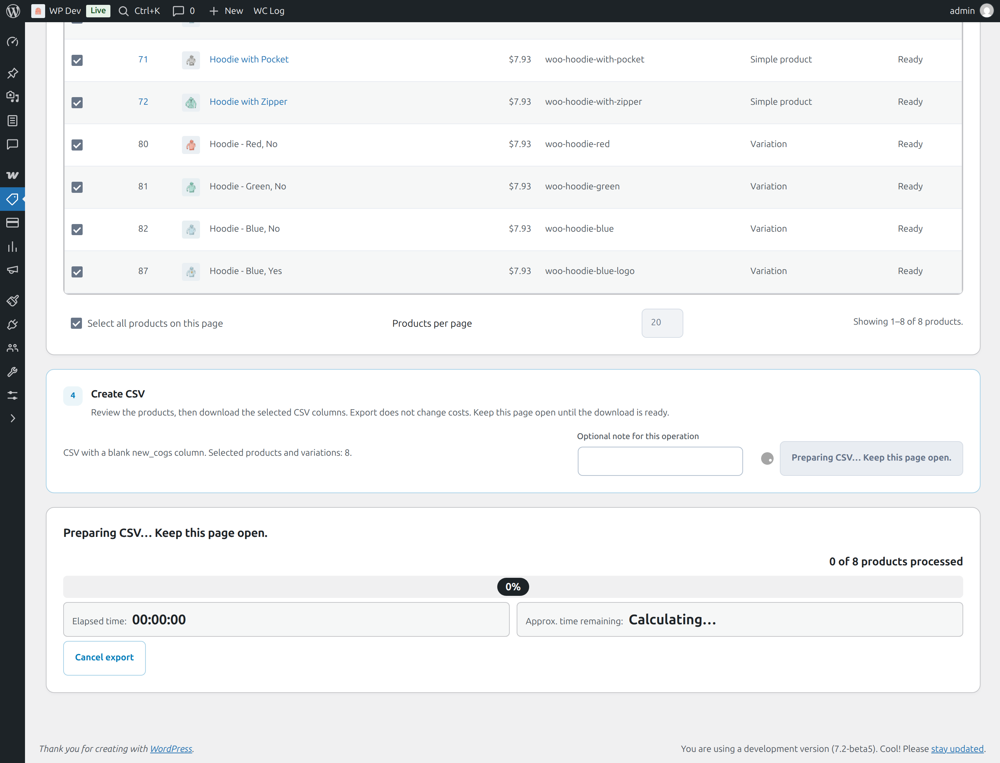

### 14. Download the completed CSV

When export finishes, use **Download CSV** to retrieve the generated file. Check the completed status and product count, then open the download in a spreadsheet application. Generated download files are temporary, so save a local copy when you need to keep the export.

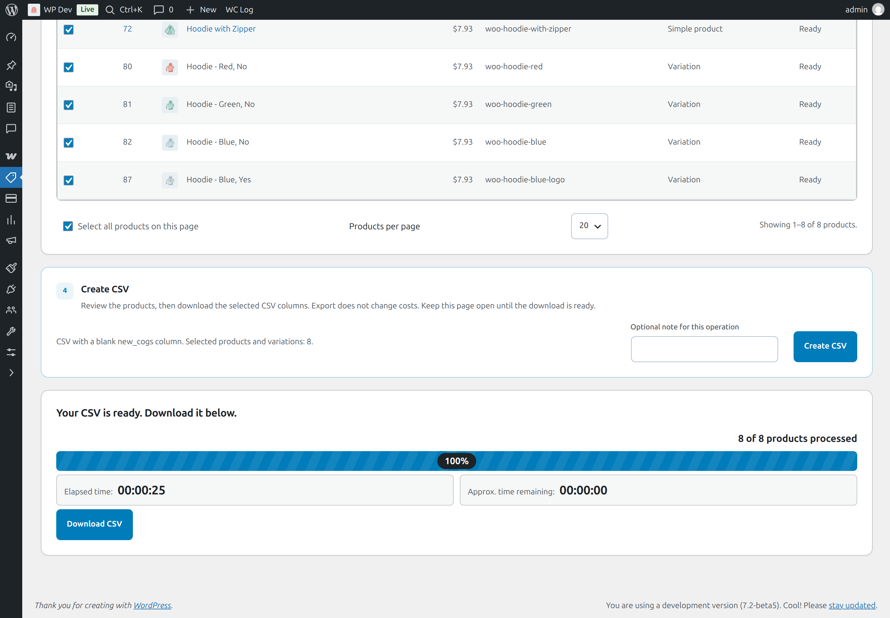

### 15. Inspect the exported spreadsheet

The exported spreadsheet shows product identifiers, existing costs, and the empty **new_cogs** column. Use these identifiers to keep each row associated with the correct product or variation. This spreadsheet image is retained unchanged from the version 1.2.0 documentation because it demonstrates the same file workflow.

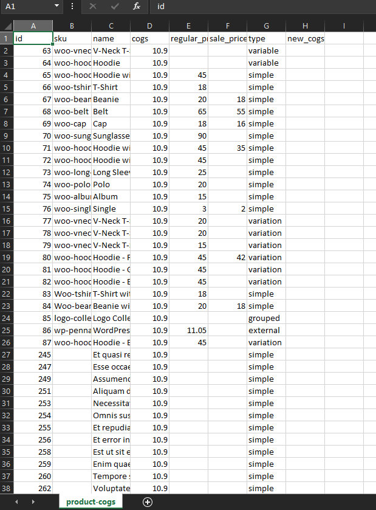

### 16. Enter replacement costs in new_cogs

Enter replacement values under **new_cogs**, keeping product IDs and SKUs intact. Use decimal points without currency symbols and save a UTF-8 CSV or XLSX file for import. Blank replacement costs are excluded from updates. This second spreadsheet image is also retained unchanged from version 1.2.0.

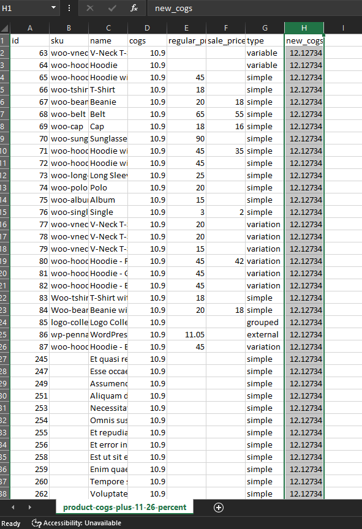

## CSV and Excel import

Import **UTF-8 CSV** or **XLSX** files. A downloadable CSV template and expandable file requirements are available beside the upload controls.

### File format

Supply `new_cogs` and at least one product identifier: `id` or `sku`.

```csv
sku,new_cogs
TSHIRT-BLUE-S,12.50
TSHIRT-BLUE-M,13.25
```

| Column | Purpose |
| --- | --- |
| `id` | WordPress product or variation ID |
| `sku` | Product or variation SKU |
| `new_cogs` | New cost, using a decimal point and no currency symbol |
| `cogs` | Current cost in exports; accepted as the legacy import value only when `new_cogs` is absent |

- If both ID and SKU are supplied, they must identify the same product.
- Blank costs are excluded. Duplicate product rows are excluded and included in the error report.
- Import values support up to six decimal places; product updates follow WooCommerce’s cost handling.
- XLSX imports read the **first worksheet’s raw cell values**. Replace formulas with values and store SKUs as text to retain leading zeros.
- WordPress’s upload limit is displayed beside the file field. The plugin has no separate file-size or row-count cap; hosting limits still apply.

### Validate, review, then apply

1. Open **Import / export** and choose **Import CSV / XLSX**.
2. Drop a CSV or XLSX file onto the upload area, or choose a file. Replace or remove it if needed.
3. Choose **Validate file** to prepare a preview in background batches.
4. Review the paginated results and download validation errors when available.
5. Select the products to update, review the confirmation, and explicitly apply the changes.
6. Review the outcome and download update reports when available.

Preparing an import preview does not update products. Preparation can be cancelled independently of an applied update, and you can close the page and return to its progress display.

Original uploads are deleted when preparation ends. Staged previews and reports expire through scheduled cleanup after approximately **24 hours**, with retention extended while an applied update is active. Generated export and report download files have scheduled cleanup after **two days**.

### 17. Upload and prepare an import

Choose **Import CSV / XLSX**, review the expandable file requirements, and select or drop a file. Choose **Validate file** to prepare its preview in background batches. This preparation checks the input and resolves products without changing their saved costs; the progress panel shows its current state.

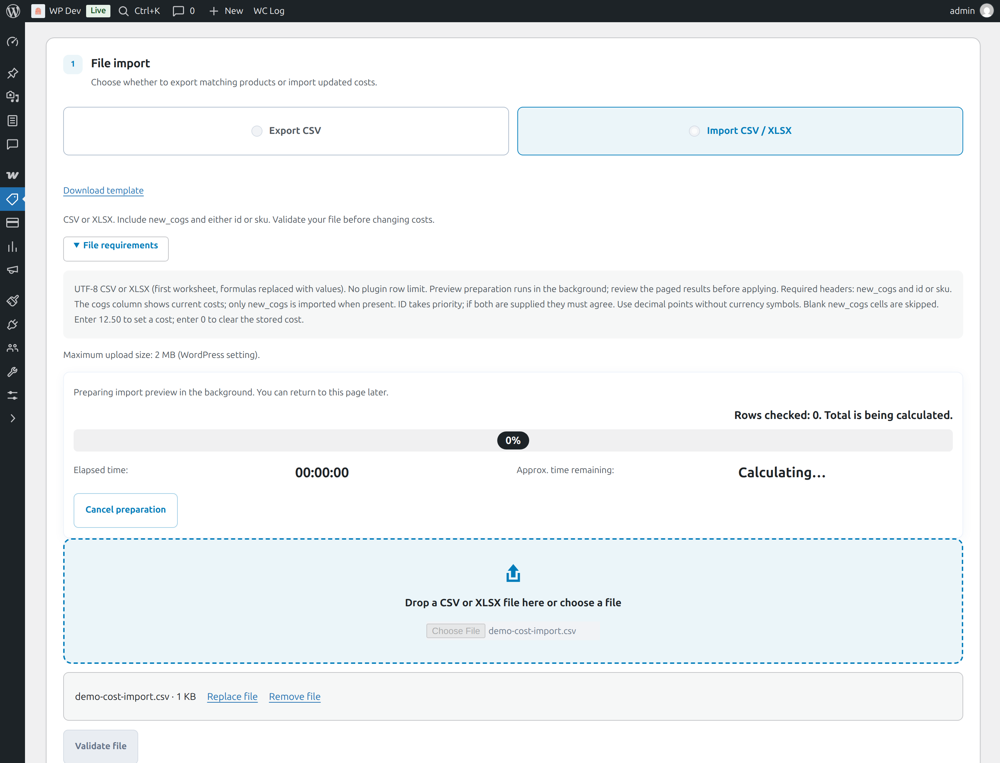

### 18. Confirm cancelling import preparation

The preparation cancellation dialog lets you stop building the import preview. Confirm to stop preparation or cancel the dialog to continue waiting. Product costs remain unchanged at this stage because importing still requires a completed preview, a selected scope, and explicit update confirmation.

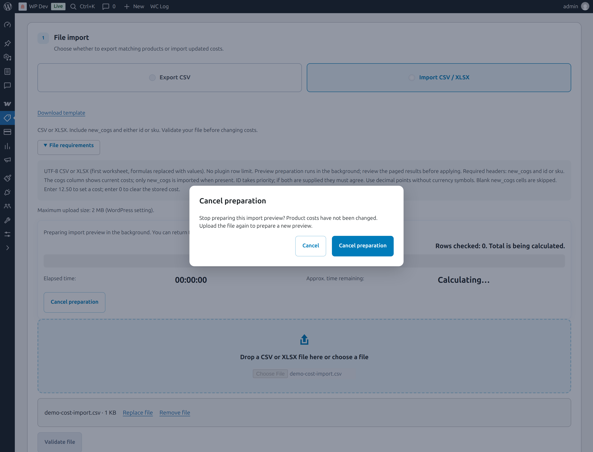

### 19. Review validated import rows

The ready preview compares current costs, proposed imported costs, and differences for each validated product. This example contains **three ready products**. Review the rows, select the intended changes, and download validation errors when available before proceeding; preparing this preview alone does not apply the file.

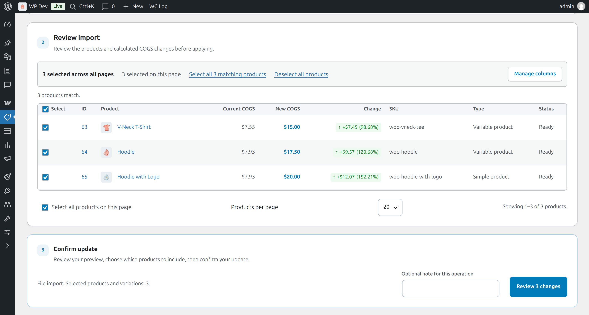

### 20. Confirm selected imported costs

Review the selected import changes in the confirmation dialog and choose whether to keep rollback history. Confirm only after checking the product scope and proposed values; applying starts a background cost update. The documentation example stops at this dialog, so it demonstrates approval without applying these imported values.

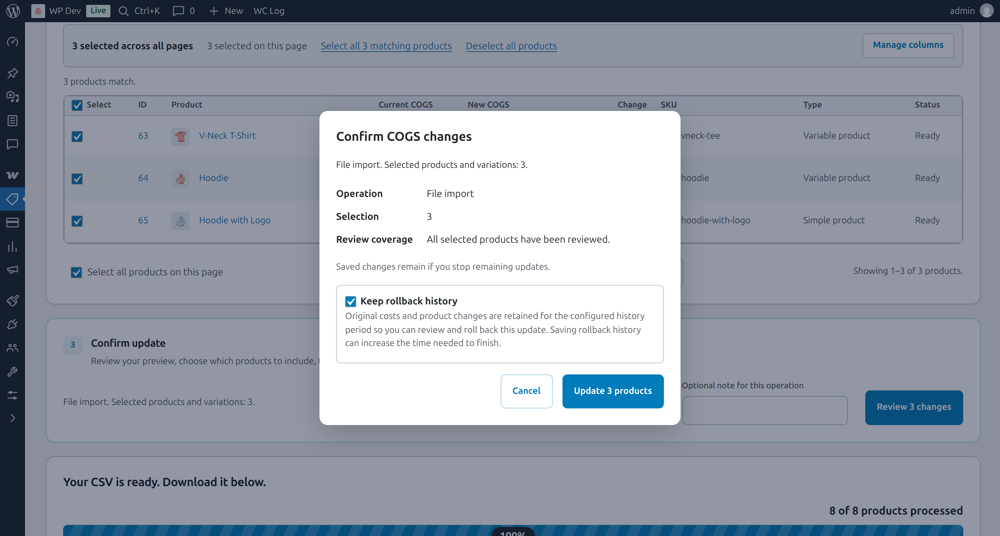

## History and rollback

The **History** tab keeps bulk updates, imports, and rollback operations
in one place. Filter by status, operation type, user, and date range, or search
by operation ID, note, or product ID. Use numbered pages, page-size choices, or
**Go to page** to navigate. An optional note entered before starting an update
helps identify it later.

Choose **View details** to inspect the action, user, filters, note, timestamps,
duration, outcome counts, and recorded original and updated product costs.
Active historical details refresh automatically and use the existing
stale-worker recovery path.

### 21. Find an operation in History

Open **History** to review bulk updates, imports, and rollbacks. Filter by status, operation type, user, or date range, or search by operation ID, note, or product ID. Use pagination to navigate results and choose **View details** for the operation you want to inspect.

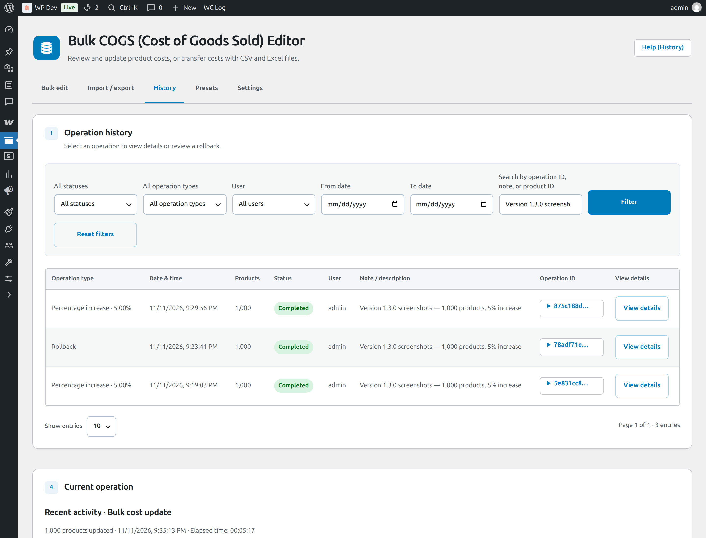

### 22. Inspect recorded product changes

Operation details show the recorded original and updated COGS, product identifiers, and differences when rollback history was retained. Review the operation summary and outcome counts alongside these rows. **Review rollback** is available for eligible source operations while the required original-cost records remain retained.

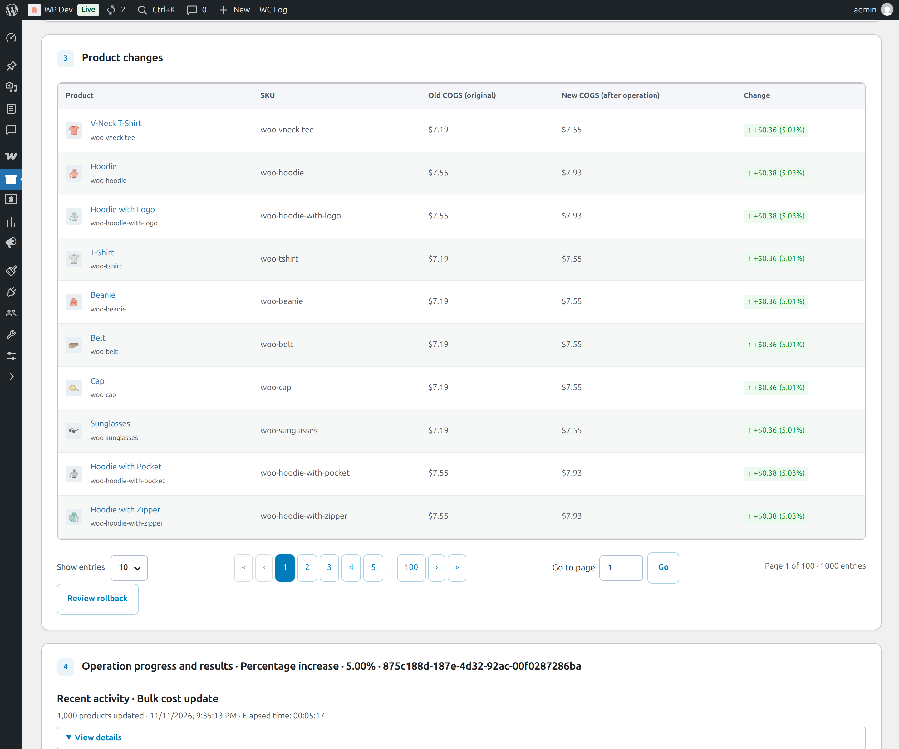

### Rollback steps and retry behavior

1. Open **History** and choose **View details** for the source update.
2. Choose **Review rollback** when retained original costs are available.
3. Compare current costs with the original values to restore and check the
   displayed rollback policy.
4. Check the confirmation and choose **Confirm rollback**.
5. Follow background progress and inspect updated, skipped, and failed counts.

A rollback restores only products with confirmed original-cost records. It uses
WooCommerce's COGS APIs, including restoring an unset original cost. Cancelling
stops remaining work; already restored values stay saved.

After a rollback is cancelled or finishes with failures or skips, return to the
source operation and review a new attempt for **remaining products only**.
Products already restored by a successful attempt are excluded, even if someone
edits their costs later. Repeated confirmation of the same attempt reuses that
attempt rather than creating another concurrent rollback.

**Older operations can have summary history only.** They cannot be rolled back
without recorded originals. Expired or deleted original values are unavailable
for rollback too. Choose **Keep rollback history** when confirming an update
to retain the product-level records needed for a later rollback review.

### 23. Review and confirm a rollback

Compare each product’s current cost with the original value to restore, then read the displayed rollback policy. Acknowledge the required confirmation before starting. The policy either overwrites current costs or skips products changed afterward; it remains fixed for that rollback attempt.

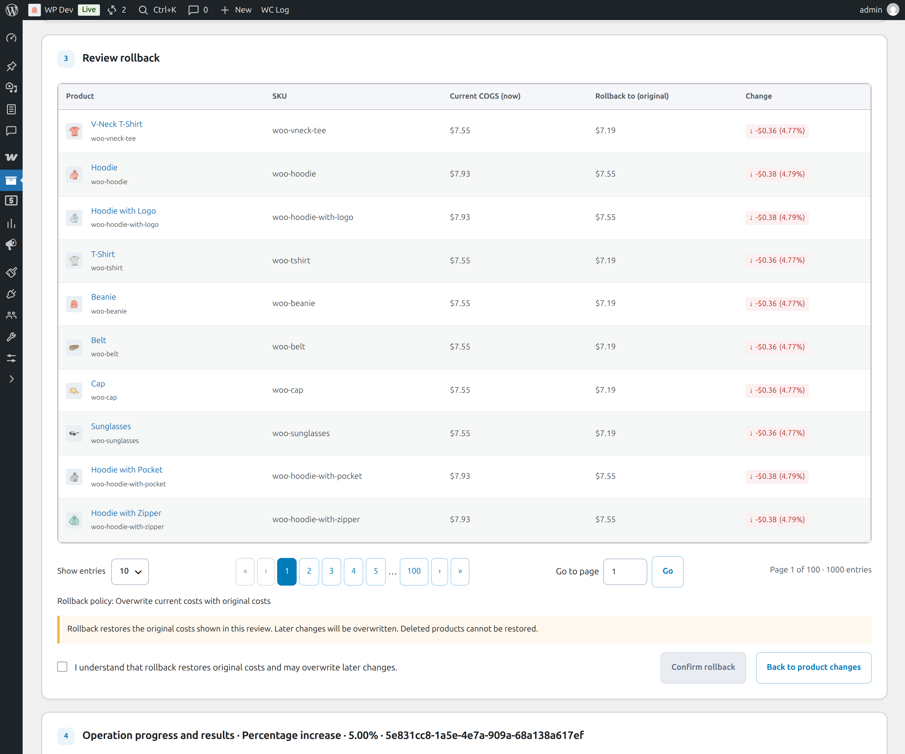

### 24. Inspect a completed rollback

The completed rollback example shows **1,000 products restored**, with **zero skipped and zero failed**. Review its outcome counters and elapsed time in History. This capture comes from an earlier restoration in the demonstration; the final bulk-update example is a separate operation.

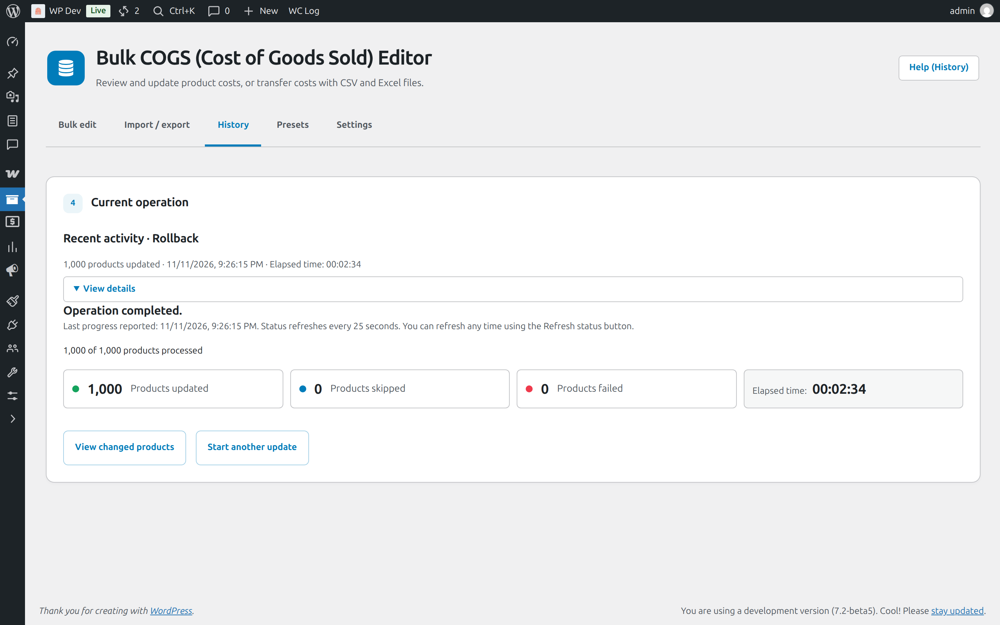

## Saved filter presets

Save frequently used filter rules from **Bulk edit** and manage them in the
**Presets** tab. Presets are stored with your WordPress user account, so they
are available across browsers and devices on the same site. Use **Edit** to
rename a preset or revise its rules; use **Delete** or the bulk actions to
remove presets. Loading a preset restores its filters, and you can run **Find
products** to check the current matching products before an update.

### 25. Manage saved filter presets

The **Presets** tab lists your account’s saved filters with creation dates and row actions. Load a preset to reuse its rules, then choose **Find products** to check current matches. Presets are available across browsers and devices when you sign into the same WordPress account on this site.

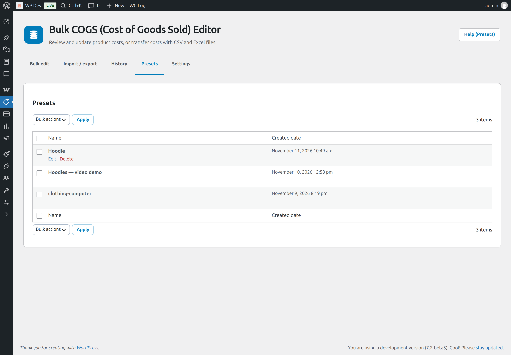

### 26. Edit a preset

Choose **Edit** on a preset to change its name or product-filter rules. Review the form and save the update, or cancel to leave the saved preset unchanged. Editing a preset changes the reusable selection rules; it does not apply a product cost update.

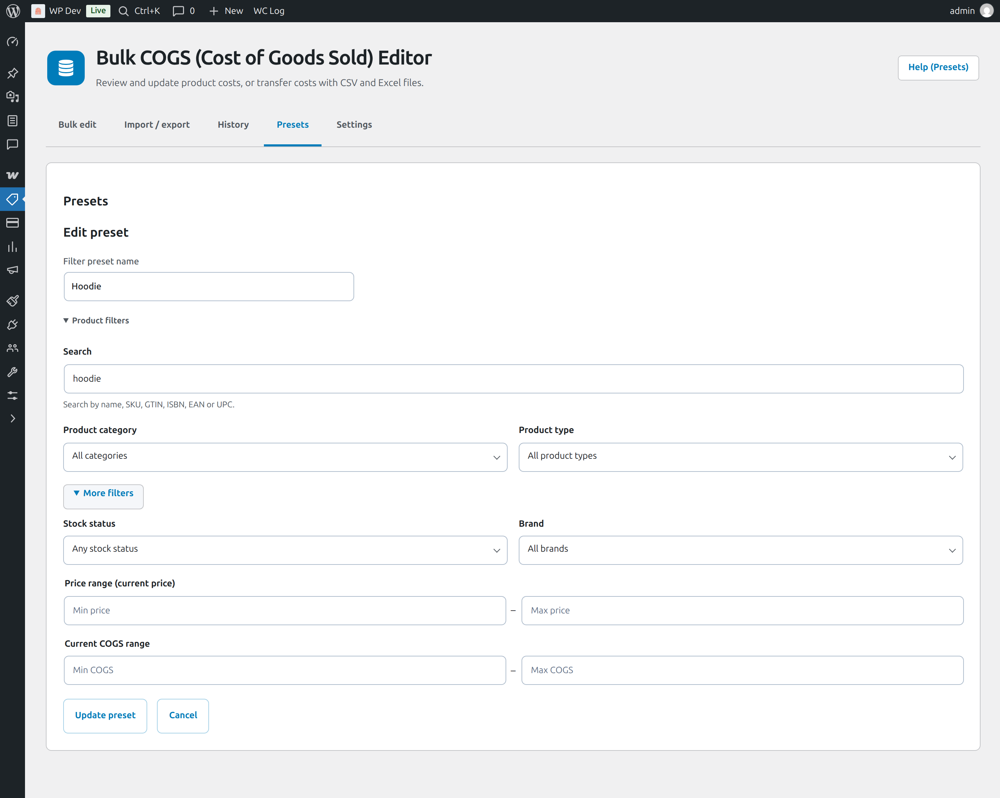

### 27. Confirm deleting one preset

Choose **Delete** on a preset to open its confirmation dialog. Check the selected preset before confirming, or cancel to keep it. Deleting a preset removes the saved filter configuration from your account; existing products, their costs, and operation history remain available.


### 28. Confirm bulk deletion of presets

Select multiple preset rows, choose the delete bulk action, and apply it to review the confirmation. Confirm only the presets you intend to remove, or cancel to preserve them. This removes the selected saved configurations without deleting products or changing their costs.

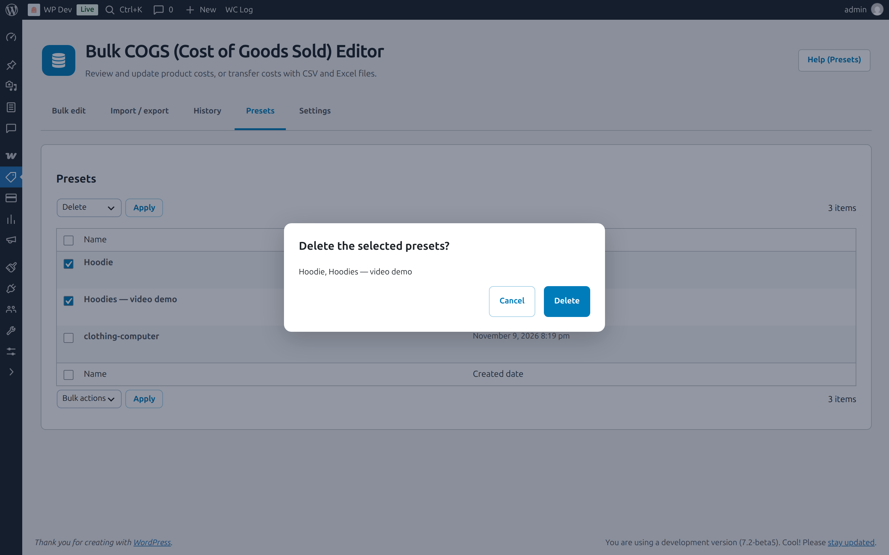

## Settings

The **Settings** tab controls retained history and the policy applied to new
rollbacks. It is shown to users with WooCommerce management access.

| Setting | Choices |
| --- | --- |
| Default rollback mode | Keep rollback history or No rollback history; overridable in each update confirmation |
| History retention | 30 days (default), 90 days, or custom days from 1 to 36,500 |
| Rollback behavior | Overwrite current costs with originals (default), or skip products whose costs changed afterward |

- **Overwrite** restores recorded original costs even after a later edit.
- **Skip changed** restores a product only when its current cost still matches
  the value saved by the source operation. Deleted products are skipped.
- The policy appears in rollback review and remains fixed for that attempt.
  Changing Settings affects new attempts.
- Retention applies to existing completed operations. Reducing it can make older
  records expire; extending it cannot recover records already deleted.
- Queued history cleanup rechecks retention before deleting. Active operations
  and their required source history are preserved until work is finished.

Choose **Save settings** to apply changes. Visiting this tab preserves your
current bulk or CSV preview and selection.

### 29. Configure history and rollback settings

In **Settings**, choose the default rollback-history mode for new updates, a history retention period, and rollback behavior. This screenshot illustrates **Keep rollback history**, **60 custom days**, and skipping products changed afterward; these example choices are unsaved. Choose **Save settings** to apply your selections. The recovery controls are available alongside these options.

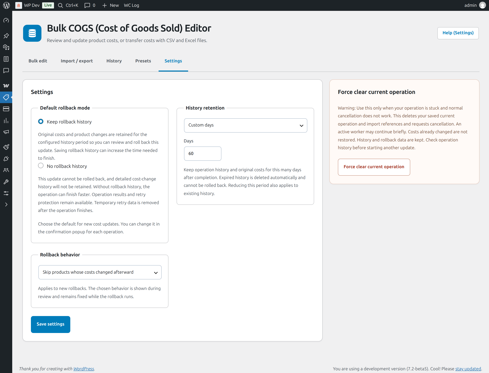

### 30. Confirm force clearing a stuck operation

Use **Force clear current operation** only when an operation is stuck and normal cancellation does not work. Confirmation clears your current operation and import references and requests cancellation. It keeps history and rollback data, does not restore changed costs, and cannot immediately stop an active worker. Check History before starting another update.

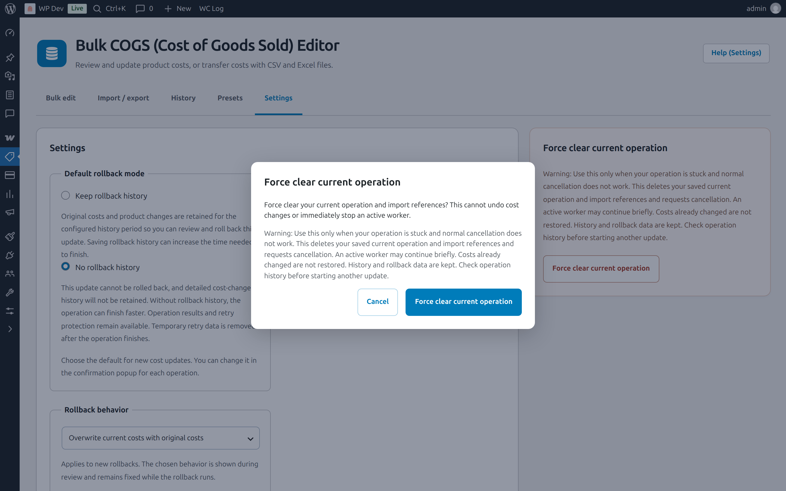

## Background processing and recovery

Updates run in **Action Scheduler** batches. The editor displays the task, processed count, progress, elapsed time, estimated remaining time when available, and updated, skipped, and failed counts. Preparation avoids a misleading percentage when the total is not yet known.

- Close the browser and return later to view progress or results.
- Request cancellation while work is running. **Already saved changes are kept; cancellation is not a rollback.**
- Saved per-product outcomes and checkpoints support recovery without blindly repeating completed updates.
- Bounded product queries, batch cache preparation, indexed outcomes, and grouped cache cleanup reduce processing overhead.
- Expand **Recent activity** to inspect the latest completed operation, including completion time, elapsed time, and any skipped or failed records.

Completed operation history, original cost records, and preview claims use the **Settings** retention period: **30 days by default**, 90 days, or custom days. Bounded daily cleanup removes expired records while preserving active operations and import report dependencies until their work is finished.

### Optional WP-CLI runner

After preparing an import or confirming an update in the editor, a host-approved CLI process can run due plugin actions:

```bash
wp action-scheduler run --group=bulk-cogs-editor --batch-size=1 --batches=0
```

This processes due Bulk COGS Editor actions for **all users on the site** and exits when no matching actions are due. The batch size counts scheduled actions, not products. Keep the normal queue runner available for delayed retries.

Import preview workers must run on the upload server as the same operating-system user as PHP so they can read private temporary uploads. See [the operational notes in readme.txt](readme.txt) for concurrency, queue status, timing logs, and hosting considerations.

### Performance

The latest reported **WP-CLI benchmark** updated **10,000 products in 15 minutes 24 seconds**, with **zero skipped and zero failed**, compared with 50–60 minutes in the initial implementation — approximately **69–74% less elapsed time**.

The reported time is the editor’s operation elapsed time, not a separately measured end-to-end CLI runtime. This is a reported single run, not a guaranteed completion time. Results depend on hosting, database speed, product mix, installed extensions, and worker availability. Repeated runs and larger-catalog benchmarks are still needed.

## Frequently asked questions

### Does this replace WooCommerce’s native COGS feature?

No. It uses WooCommerce’s native feature and requires it to be enabled. The plugin changes product cost values; selling prices remain unchanged.

### Can I preview without changing my store?

Yes. Product previews and import validation do not change costs. An update requires explicit confirmation.

### Why did a percentage or fixed adjustment skip some products?

Relative actions skip records without a saved COGS value. Use **Set exact cost** to assign those records a cost.

### Why does selecting every category differ from leaving the category filter empty?

Selecting categories requires a matching category assignment. Products without categories, and variations whose parents have no matching categories, are excluded. Clear the category selection to remove that restriction.

### Can I update variations without changing their parents?

Yes. Filter for variations and review the resulting records. Variations have their own COGS values and are updated separately.

### Why are some preview controls disabled?

The editor disables selection and confirmation while results are outdated or loading, and prevents conflicting changes during an active update. Refresh the preview when prompted and review the current results.

### Is cancellation the same as rollback?

No. Cancellation stops remaining work and keeps saved changes. Use **History →
View details → Review rollback** to review restoring retained original costs.

### Can rollback overwrite a later cost edit?

Yes, with the default overwrite policy. Choose **Skip products whose costs
changed afterward** in Settings if later edits should be left alone. Every
attempt shows its policy before confirmation.

### Why is rollback unavailable for an older operation?

It may have summary-only history, no recorded original values, expired history,
or an active rollback. Original costs cannot be reconstructed from the operation
summary. A terminal incomplete rollback can be reviewed again for remaining
recorded products.

### Does the plugin send store data to external services?

No. Product matching, calculations, previews, imports, exports, and cost updates run on your WordPress installation.

## Development and support

Frontend sources are in `src/`; generated production assets are in `assets/`. Backend code is in `admin/`, with bootstrap and compatibility declarations in `bulk-cogs-editor-for-woocommerce.php`.

For a source checkout:

```bash
npm ci
npm run build
```

Use the repository’s [project instructions](AGENTS.md) for contribution conventions and supported checks. See [readme.txt](readme.txt) for the full release history, including version **1.3.0**.

- [Usage documentation](https://wpbydinesh.wordpress.com/2026/10/11/bulk-edit-woocommerce-cogs/)
- [Video demonstration](https://youtu.be/sOEOg0xiqYs)
- [Issues and feature requests](https://github.com/dineshinau/bulk-cogs-editor-for-woocommerce/issues)
- [Performance discussion](https://github.com/dineshinau/bulk-cogs-editor-for-woocommerce/discussions/12)

The 30 screenshots follow the version **1.3.0** workflow. New admin captures use the **wpdev** development store, the default WordPress color scheme, and a collapsed sidebar. Screenshots 15–16 preserve the original version **1.2.0** spreadsheet examples unchanged. Product data and results are illustrative; progress screenshots show an actual 1,000-product operation, and the rollback example shows an earlier restoration. Licensed under [GPLv3](https://www.gnu.org/licenses/gpl-3.0.html).
