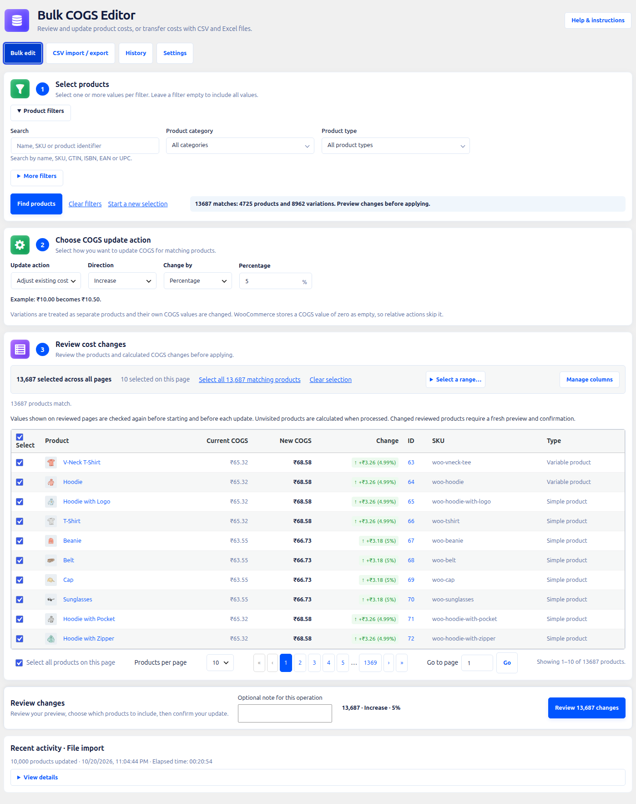
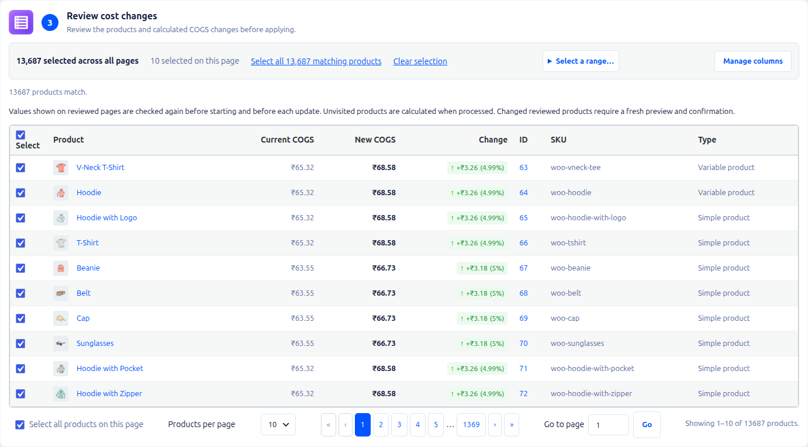
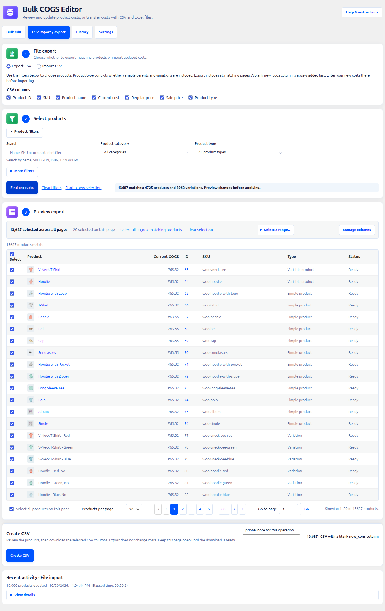
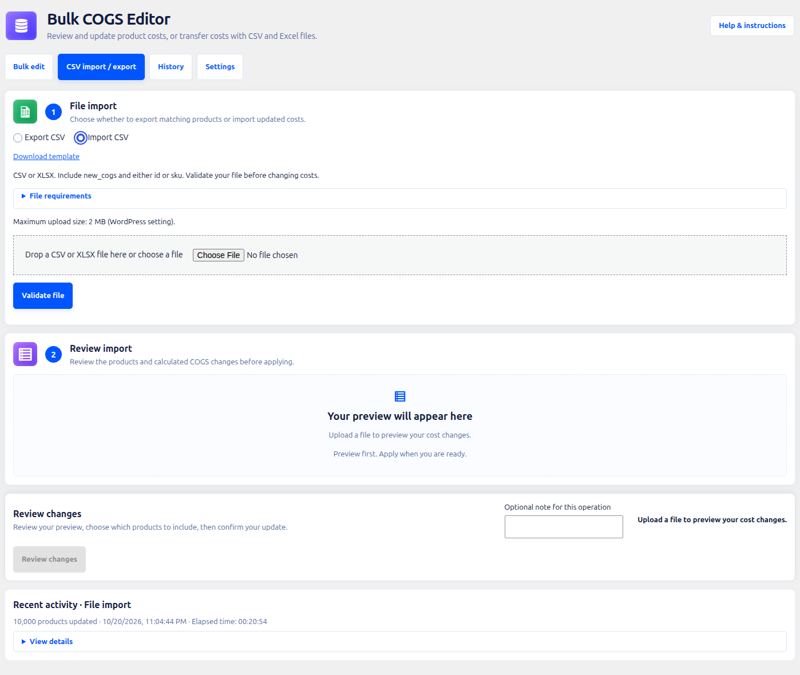
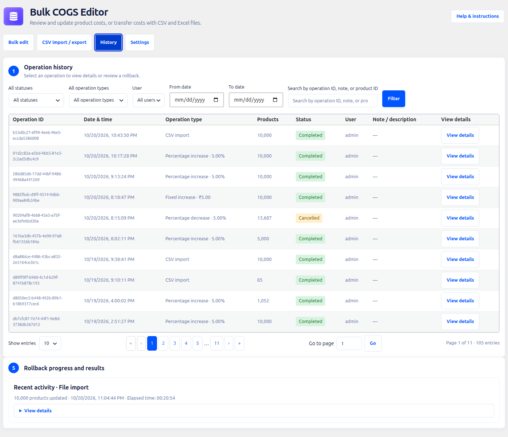
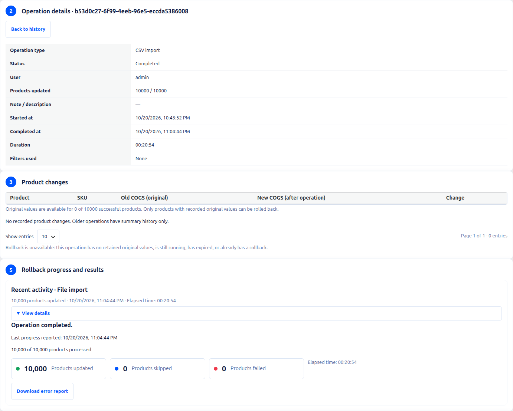
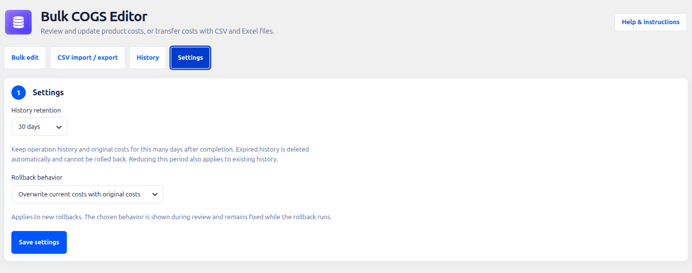

# Bulk COGS Editor for WooCommerce

Review and update product costs in bulk, or transfer costs with CSV and Excel files, directly from your WooCommerce admin.

Bulk COGS Editor works with **WooCommerce’s native Cost of Goods Sold (COGS)** feature. Find the right products, preview the exact changes, choose which records to update, and explicitly confirm before background processing starts. Product selling prices stay untouched. Inspect past operations in **History**, review a rollback to recorded original costs, and choose retention and rollback behavior in **Settings**.

**Version:** 1.1.2 · **License:** GPLv3 · **HPOS compatible**

[Documentation](https://dineshinaublog.wordpress.com/2026/10/11/bulk-edit-woocommerce-cogs/) · [Video demonstration](https://www.youtube.com/watch?v=R-kw_6g2JIg) · [Report an issue](https://github.com/dineshinau/bulk-cogs-editor-for-woocommerce/issues)



## Contents

- [Requirements and installation](#requirements-and-installation)
- [Features](#features)
- [Bulk editing workflow](#bulk-editing-workflow)
- [CSV export](#csv-export)
- [CSV and Excel import](#csv-and-excel-import)
- [History and rollback](#history-and-rollback)
- [Settings](#settings)
- [Background processing and recovery](#background-processing-and-recovery)
- [Frequently asked questions](#frequently-asked-questions)
- [Development and support](#development-and-support)

## Requirements and installation

| Requirement | Minimum |
| --- | --- |
| WordPress | 6.7+ |
| WooCommerce | 10.3+ |
| PHP | 7.4+ |
| WooCommerce COGS | Enabled in WooCommerce settings |

1. Install the plugin through WordPress, or upload the plugin folder to `wp-content/plugins/bulk-cogs-editor-for-woocommerce/`.
2. Activate **Bulk COGS Editor for WooCommerce**.
3. Enable WooCommerce’s native Cost of Goods Sold feature.
4. Open **Products → Bulk COGS Editor**.

If COGS is unavailable or disabled, the editor explains what is required. Use a packaged plugin build when installing a ZIP; a source checkout needs its dependencies and compiled assets for development.

## Features

Version **1.1.2** adds CSV and Excel transfer workflows, a searchable **History**
tab with reviewed background rollbacks, and a **Settings** tab for retention and
rollback policy. Recovery fixes preserve recorded changes, allow retries for
remaining rollback products, and keep editor drafts when switching tabs.

### Find the products you need

- Combine searches by product name, SKU, GTIN, ISBN, EAN, or UPC with category, product type, stock status, brand, price, and current COGS filters.
- Search inside multi-select filter menus, select individual options or all options, and see selected-option counts.
- Include child categories when choosing a parent category. Variations match categories through their parent product.
- Keep primary filters close at hand and expand **More filters** for additional criteria.
- Remove individual filter chips, clear filters, or start a new selection.
- See the full matching count with separate product and variation totals.

Brand filtering appears when a public product brand taxonomy is available. Category option counts come from WooCommerce’s stored product counts; the matching result count reflects the current filter combination.

### Set, adjust, or clear costs

| Action | Example |
| --- | --- |
| Set exact cost | Set matching products to 25.00 |
| Increase by percentage | Increase existing costs by 5% |
| Decrease by percentage | Reduce existing costs by 10% |
| Increase by fixed amount | Add 2.50 to existing costs |
| Decrease by fixed amount | Subtract 1.00 from existing costs |
| Clear cost | Remove the saved COGS value |

The editor shows contextual fields, an illustrative before-and-after example, and a warning for clearing costs. Calculations use store decimal precision and half-up rounding; decreases stop at zero.

Relative adjustments skip products without a saved cost. Use **Set exact cost** to assign missing costs. WooCommerce treats zero as an empty cost; clearing uses the COGS API’s null value.

### Preview and choose your update scope

- Compare current COGS, new COGS, and the amount and percentage of each change before applying. Increases are green and decreases red, with directional arrows.
- Keep your preview and selection when visiting History or Settings and returning to the same editor.
- Identify products through images, names, SKUs, and product edit links.
- Show or hide optional columns and retain display preferences.
- Browse 10, 20, 50, or 100 records per page, or jump directly to a page.
- Select the current page, all matches, individual records across pages, or the first or last number of matches.
- See the selection total across pages and keep the action visible in a sticky summary.
- Review the action, selection scope, and preview review coverage in the confirmation dialog.

Individual selections support up to **500 products**. All-matching and range selections support larger scopes. Outdated preview rows remain visible for context, but selection and confirmation are disabled until fresh results are ready. A nearby **Refresh preview** control helps recover when needed.



### Guidance and responsive controls

Help and instructions follow the selected **Bulk edit**, **CSV Import**, or **CSV Export** task. File requirements, cost examples, nearby validation messages, and recovery controls guide each workflow. Documentation and video links remain available.

The interface uses colored workflow icons, clear step numbers, larger mobile touch controls, sticky table headers, and fixed selection and product columns on small screens. The action summary accounts for device safe areas.

### Product and variation support

Costs are written through WooCommerce CRUD APIs for simple, variable, grouped, external, and custom product types, and for variations. Variations are separate records: selecting only variations does not change their variable parent’s cost.

## Bulk editing workflow

1. Choose **Bulk edit**.
2. Set your filters and choose **Find products**.
3. Choose **Set exact cost**, **Adjust existing cost**, or **Clear cost**. Enter the value where applicable.
4. Review the automatically generated preview and select the products to update.
5. Choose **Review changes**, inspect the confirmation summary, and confirm when ready.
6. Follow progress and review the final outcome.

Previewing does not change product costs. Updating begins only after confirmation.

## CSV export

Use exports to review existing costs in a spreadsheet or prepare a file for importing new values.

1. Choose **CSV import / export → Export CSV**.
2. Choose the output columns and filter the products.
3. Find and preview the matching products.
4. Start the export and wait for server-side file generation.
5. Use the explicit download link when the file is ready.

Exports cover **all matching pages** and always append a blank `new_cogs` column. Fill that column to prepare cost updates. Product type filters determine whether variable parents, variations, or both are included. Export produces CSV, including when the source of a previous import was XLSX.



## CSV and Excel import

Import **UTF-8 CSV** or **XLSX** files. A downloadable CSV template and expandable file requirements are available beside the upload controls.



### File format

Supply `new_cogs` and at least one product identifier: `id` or `sku`.

```csv
sku,new_cogs
TSHIRT-BLUE-S,12.50
TSHIRT-BLUE-M,13.25
```

| Column | Purpose |
| --- | --- |
| `id` | WordPress product or variation ID |
| `sku` | Product or variation SKU |
| `new_cogs` | New cost, using a decimal point and no currency symbol |
| `cogs` | Current cost in exports; accepted as the legacy import value only when `new_cogs` is absent |

- If both ID and SKU are supplied, they must identify the same product.
- Blank costs are excluded. Duplicate product rows are excluded and included in the error report.
- Import values support up to six decimal places; product updates follow WooCommerce’s cost handling.
- XLSX imports read the **first worksheet’s raw cell values**. Replace formulas with values and store SKUs as text to retain leading zeros.
- WordPress’s upload limit is displayed beside the file field. The plugin has no separate file-size or row-count cap; hosting limits still apply.

### Validate, review, then apply

1. Choose **CSV import / export → Import CSV**.
2. Drop a CSV or XLSX file onto the upload area, or choose a file. Replace or remove it if needed.
3. Choose **Validate file** to prepare a preview in background batches.
4. Review the paginated results and download validation errors when available.
5. Select the products to update, review the confirmation, and explicitly apply the changes.
6. Review the outcome and download update reports when available.

Preparing an import preview does not update products. Preparation can be cancelled independently of an applied update, and you can close the page and return to its progress display.

Original uploads are deleted when preparation ends. Staged previews and reports expire through scheduled cleanup after approximately **24 hours**, with retention extended while an applied update is active. Generated export and report download files have scheduled cleanup after **two days**.

## History and rollback

The third tab, **History**, keeps bulk updates, imports, and rollback operations
in one place. Filter by status, operation type, user, and date range, or search
by operation ID, note, or product ID. Use numbered pages, page-size choices, or
**Go to page** to navigate. An optional note entered before starting an update
helps identify it later.



Choose **View details** to inspect the action, user, filters, note, timestamps,
duration, outcome counts, and recorded original and updated product costs.
Active historical details refresh automatically and use the existing
stale-worker recovery path.



### Review and confirm a rollback

1. Open **History** and choose **View details** for the source update.
2. Choose **Review rollback** when retained original costs are available.
3. Compare current costs with the original values to restore and check the
   displayed rollback policy.
4. Check the confirmation and choose **Confirm rollback**.
5. Follow background progress and inspect updated, skipped, and failed counts.

A rollback restores only products with confirmed original-cost records. It uses
WooCommerce's COGS APIs, including restoring an unset original cost. Cancelling
stops remaining work; already restored values stay saved.

After a rollback is cancelled or finishes with failures or skips, return to the
source operation and review a new attempt for **remaining products only**.
Products already restored by a successful attempt are excluded, even if someone
edits their costs later. Repeated confirmation of the same attempt reuses that
attempt rather than creating another concurrent rollback.

**Older operations can have summary history only.** They cannot be rolled back
without recorded originals. Expired or deleted original values are unavailable
for rollback too. The wpdev store used for these screenshots currently has only
summary records, so its details screenshot shows that actual limitation; no
sample operations or product updates were created for the screenshots.

## Settings

The fourth tab, **Settings**, controls retained history and the policy applied to
new rollbacks.



| Setting | Choices |
| --- | --- |
| History retention | 30 days (default), 90 days, or custom days from 1 to 36,500 |
| Rollback behavior | Overwrite current costs with originals (default), or skip products whose costs changed afterward |

- **Overwrite** restores recorded original costs even after a later edit.
- **Skip changed** restores a product only when its current cost still matches
  the value saved by the source operation. Deleted products are skipped.
- The policy appears in rollback review and remains fixed for that attempt.
  Changing Settings affects new attempts.
- Retention applies to existing completed operations. Reducing it can make older
  records expire; extending it cannot recover records already deleted.
- Queued history cleanup rechecks retention before deleting. Active operations
  and their required source history are preserved until work is finished.

Choose **Save settings** to apply changes. Visiting this tab preserves your
current bulk or CSV preview and selection.

## Background processing and recovery

Updates run in **Action Scheduler** batches. The editor displays the task, processed count, progress, elapsed time, estimated remaining time when available, and updated, skipped, and failed counts. Preparation avoids a misleading percentage when the total is not yet known.

- Close the browser and return later to view progress or results.
- Request cancellation while work is running. **Already saved changes are kept; cancellation is not a rollback.**
- Saved per-product outcomes and checkpoints support recovery without blindly repeating completed updates.
- Bounded product queries, batch cache preparation, indexed outcomes, and grouped cache cleanup reduce processing overhead.
- Expand **Recent activity** to inspect the latest completed operation, including completion time, elapsed time, and any skipped or failed records.

Completed operation history, original cost records, and preview claims use the **Settings** retention period: **30 days by default**, 90 days, or custom days. Bounded daily cleanup removes expired records while preserving active operations and import report dependencies until their work is finished.

### Optional WP-CLI runner

After preparing an import or confirming an update in the editor, a host-approved CLI process can run due plugin actions:

```bash
wp action-scheduler run --group=bulk-cogs-editor --batch-size=1 --batches=0
```

This processes due Bulk COGS Editor actions for **all users on the site** and exits when no matching actions are due. The batch size counts scheduled actions, not products. Keep the normal queue runner available for delayed retries.

Import preview workers must run on the upload server as the same operating-system user as PHP so they can read private temporary uploads. See [the operational notes in readme.txt](readme.txt) for concurrency, queue status, timing logs, and hosting considerations.

### Performance

The developer’s [reported benchmark](https://github.com/dineshinau/bulk-cogs-editor-for-woocommerce/discussions/12) updated **10,000 products in 21 minutes 34 seconds**, with zero skipped and zero failed, compared with 50–60 minutes in the initial implementation.

This is a reported single run, not a guaranteed completion time. Results depend on hosting, database speed, product mix, installed extensions, and worker availability. Repeated runs and larger-catalog benchmarks are still needed.

## Frequently asked questions

### Does this replace WooCommerce’s native COGS feature?

No. It uses WooCommerce’s native feature and requires it to be enabled. The plugin changes product cost values; selling prices remain unchanged.

### Can I preview without changing my store?

Yes. Product previews and import validation do not change costs. An update requires explicit confirmation.

### Why did a percentage or fixed adjustment skip some products?

Relative actions skip records without a saved COGS value. Use **Set exact cost** to assign those records a cost.

### Why does selecting every category differ from leaving the category filter empty?

Selecting categories requires a matching category assignment. Products without categories, and variations whose parents have no matching categories, are excluded. Clear the category selection to remove that restriction.

### Can I update variations without changing their parents?

Yes. Filter for variations and review the resulting records. Variations have their own COGS values and are updated separately.

### Why are some preview controls disabled?

The editor disables selection and confirmation while results are outdated or loading, and prevents conflicting changes during an active update. Refresh the preview when prompted and review the current results.

### Is cancellation the same as rollback?

No. Cancellation stops remaining work and keeps saved changes. Use **History →
View details → Review rollback** to review restoring retained original costs.

### Can rollback overwrite a later cost edit?

Yes, with the default overwrite policy. Choose **Skip products whose costs
changed afterward** in Settings if later edits should be left alone. Every
attempt shows its policy before confirmation.

### Why is rollback unavailable for an older operation?

It may have summary-only history, no recorded original values, expired history,
or an active rollback. Original costs cannot be reconstructed from the operation
summary. A terminal incomplete rollback can be reviewed again for remaining
recorded products.

### Does the plugin send store data to external services?

No. Product matching, calculations, previews, imports, exports, and cost updates run on your WordPress installation.

## Development and support

Frontend sources are in `src/`; generated production assets are in `assets/`. Backend code is in `admin/`, with bootstrap and compatibility declarations in `bulk-cogs-editor-for-woocommerce.php`.

For a source checkout:

```bash
npm ci
npm run build
```

Use the repository’s [project instructions](AGENTS.md) for contribution conventions and supported checks. See [readme.txt](readme.txt) for the full release history, including version **1.1.2**.

- [Usage documentation](https://dineshinaublog.wordpress.com/2026/10/11/bulk-edit-woocommerce-cogs/)
- [Video demonstration](https://www.youtube.com/watch?v=R-kw_6g2JIg)
- [Issues and feature requests](https://github.com/dineshinau/bulk-cogs-editor-for-woocommerce/issues)
- [Performance discussion](https://github.com/dineshinau/bulk-cogs-editor-for-woocommerce/discussions/12)

Screenshots were captured from the **wpdev** development store using its existing products and operation history; product data and results are illustrative. Licensed under [GPLv3](https://www.gnu.org/licenses/gpl-3.0.html).
